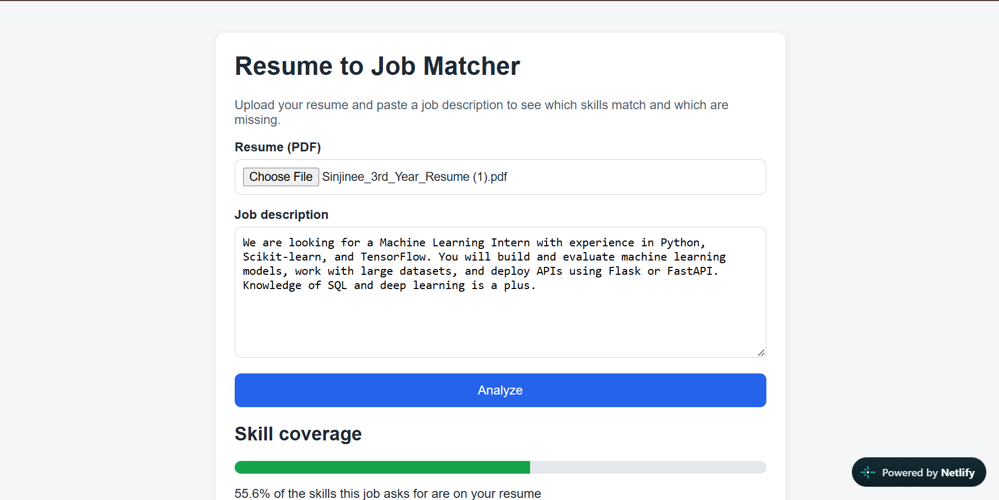
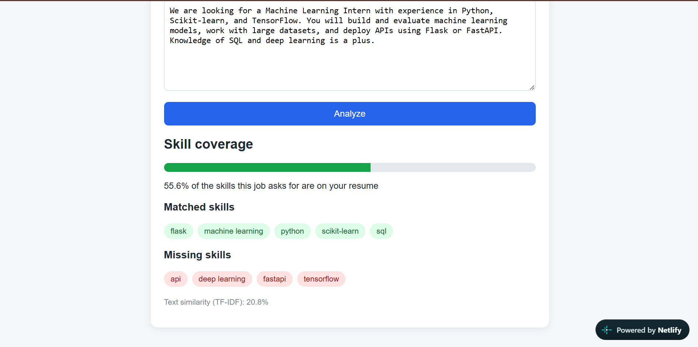

# Resume to Job Matcher

Upload a resume (PDF) and paste a job description to see which skills match, which are missing, and a text-similarity score.

**Live demo:** https://resume-job-matcher-sinjinee.netlify.app
(The backend runs on a free server, so the first request can take up to a minute to wake it.)

## How it works
1. Extracts text from the PDF resume (pdfplumber)
2. Finds skills in both texts using a skills dictionary with word-boundary regex
3. Cleans the text (lowercasing, stopword removal, lemmatization) and computes TF-IDF cosine similarity
4. Returns skill coverage, matched skills, missing skills and the similarity score

## Tech stack
Python, Flask, scikit-learn, NLTK, pdfplumber | HTML, CSS, JavaScript | Render (API), Netlify (frontend)

## Challenges and fixes
- PDF text extraction dropped spaces in LaTeX resumes, so phrases like "Random Forest" were missed. Fixed by tuning `x_tolerance`.
- Default tokenization removed symbols, breaking "C++" and "C#". Fixed with a custom token pattern.
- Lemmatization changed technical terms ("pandas" became "panda"), so skills are matched on the raw text.

## Limitations
- TF-IDF only matches exact words, so synonyms are missed
- The skills list is hand-made
- Scanned (image-only) PDFs are not supported

## Planned improvements
Sentence-embedding similarity (all-MiniLM-L6-v2) and an evaluation on labeled resume/job pairs.

## Run locally
    pip install -r backend/requirements.txt
    cd backend && python app.py
Then open frontend/index.html (change API_URL in script.js to http://127.0.0.1:5000/analyze).

## Screenshots

